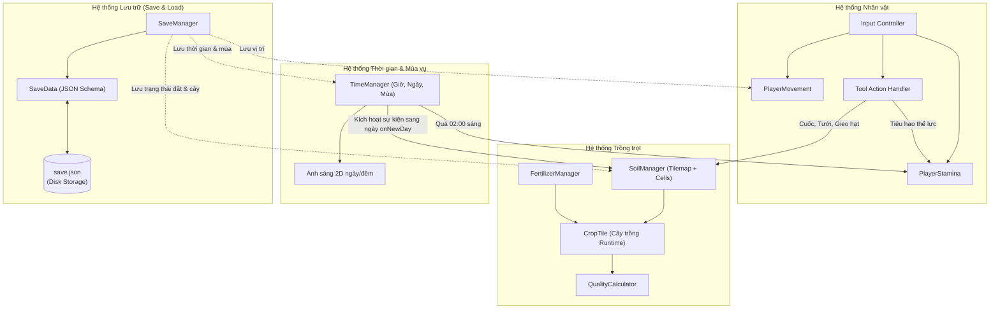

# Tài liệu Thiết kế Kiến trúc Dự án: Farm RPG (Totnghiep2026)

Hệ thống tài liệu thiết kế kỹ thuật (Technical Design Documents) dành cho dự án game nông trại **Farm RPG (Totnghiep2026)** xây dựng trên nền tảng **Unity 2D**.

---

## 📑 Danh mục Tài liệu

| Tài liệu | Mô tả trọng tâm | Liên kết |
|---|---|---|
| **Văn bản Đồ án Tốt nghiệp (Tổng hợp)** | Nội dung hoàn chỉnh chuẩn học thuật cho các mục 3.2, 3.3, 3.4 và 3.15.1, 3.15.2, 3.15.3 (Player, Farming, Save/Load). | [Xem chi tiết](file:///d:/Game_Project/Totnghiep2026/docs/bao_cao_do_an_player_farming_save.md) |
| **Hệ thống Nhân vật (Player)** | Điều khiển di chuyển, hoạt ảnh 4 hướng, cơ chế thể lực (Stamina: Normal / Exhausted / Passout), thanh công cụ và tương tác NPC/đồ vật. | [Xem chi tiết](file:///d:/Game_Project/Totnghiep2026/docs/player_design.md) |
| **Hệ thống Trồng trọt (Farming)** | Quy hoạch Tilemap đất, vòng đời cây trồng (Hạt giống $\to$ Chín $\to$ Tái sinh/Héo úa), chu kỳ tưới nước, phân bón và chất lượng nông sản. | [Xem chi tiết](file:///d:/Game_Project/Totnghiep2026/docs/farming_design.md) |
| **Hệ thống Lưu & Tải dữ liệu (Save/Load)** | Mô hình gom cụm dữ liệu (Data Aggregation), cấu trúc JSON lưu trữ, cơ chế khôi phục trạng thái thế giới (World Reconstruction) khi nạp game. | [Xem chi tiết](file:///d:/Game_Project/Totnghiep2026/docs/save_load_design.md) |
| **Luồng Sinh Cây trên Bản đồ** | Luồng tạo địa hình, giải thuật rải cây/bụi rậm và cơ chế chặt hạ rớt gỗ. | [Xem chi tiết](file:///d:/Game_Project/Totnghiep2026/tree_spawn_flow.md) |

---

## 🏛️ Sơ đồ Tương tác Tổng thể Giữa các Hệ thống

---

## 🚀 Hướng dẫn Đọc tài liệu

1. Nếu bạn đang tập trung vào cơ chế gameplay điều khiển nhân vật, bắt đầu từ [**Tài liệu Hệ thống Nhân vật**](file:///d:/Game_Project/Totnghiep2026/docs/player_design.md).
2. Nếu bạn cần nắm cơ chế vòng đời hạt giống, đất, phân bón và thu hoạch, xem [**Tài liệu Hệ thống Trồng trọt**](file:///d:/Game_Project/Totnghiep2026/docs/farming_design.md).
3. Nếu bạn phụ trách đồng bộ dữ liệu, bảo toàn màn chơi và sửa lỗi khi nạp lại game, xem [**Tài liệu Hệ thống Lưu & Tải dữ liệu**](file:///d:/Game_Project/Totnghiep2026/docs/save_load_design.md).
