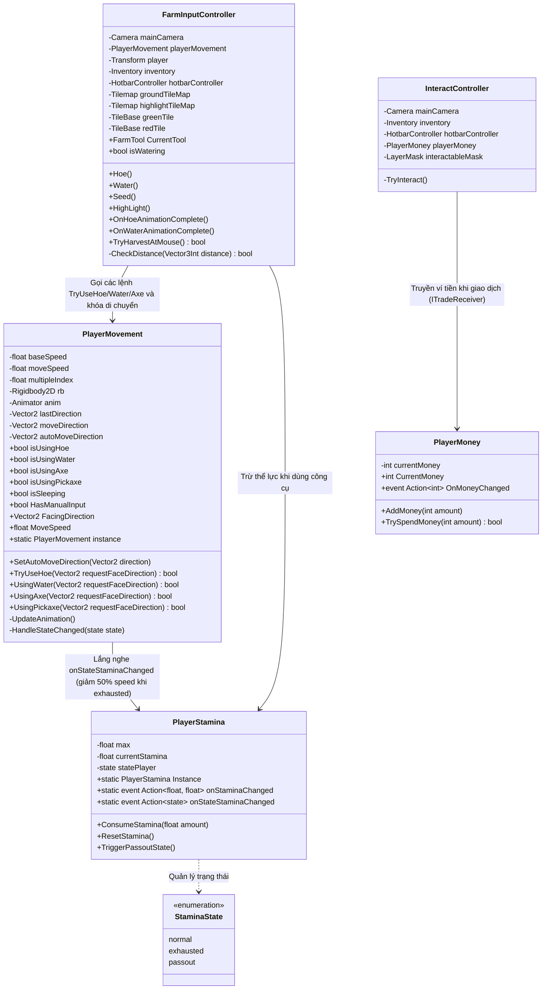
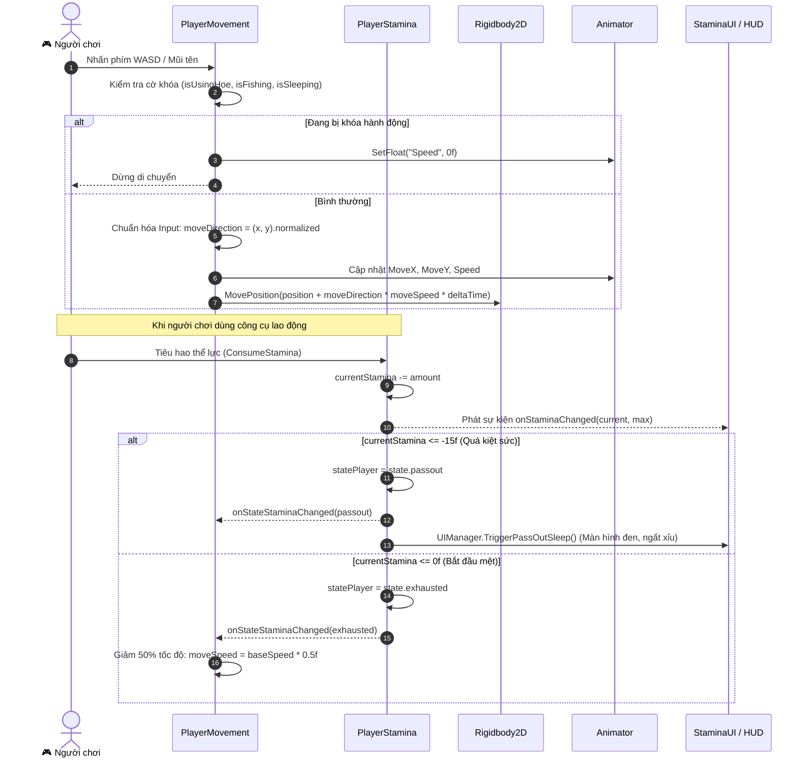
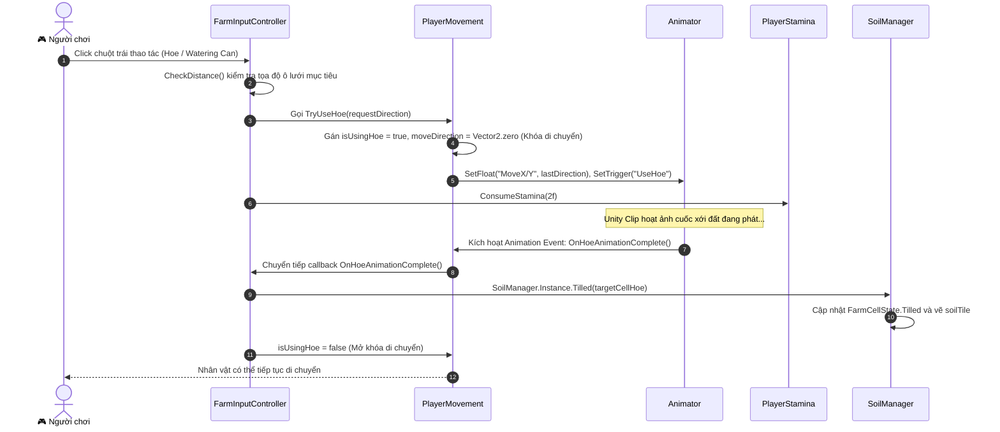
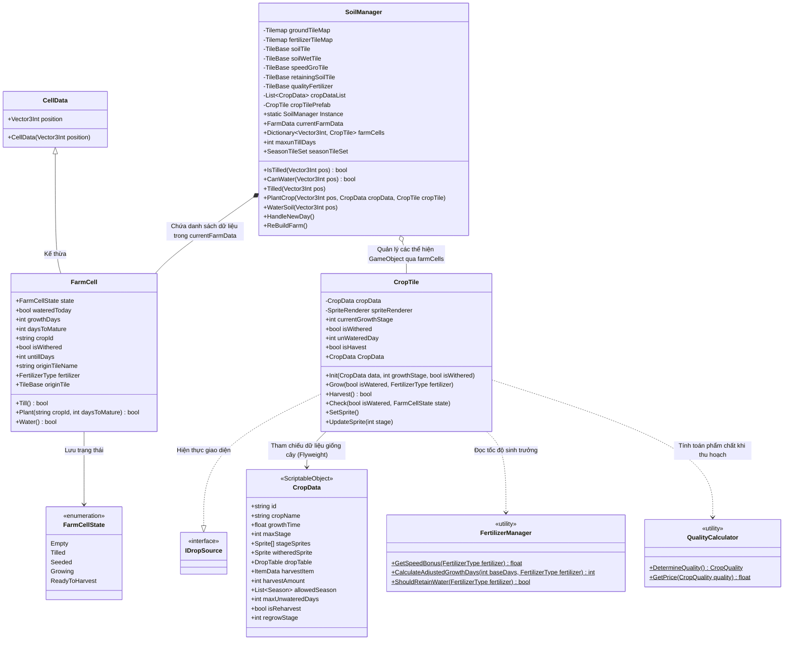
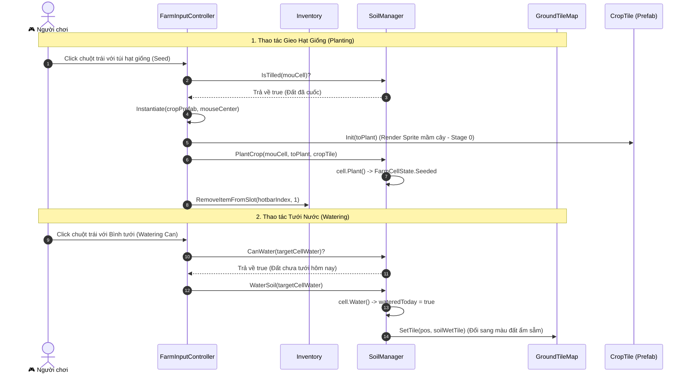
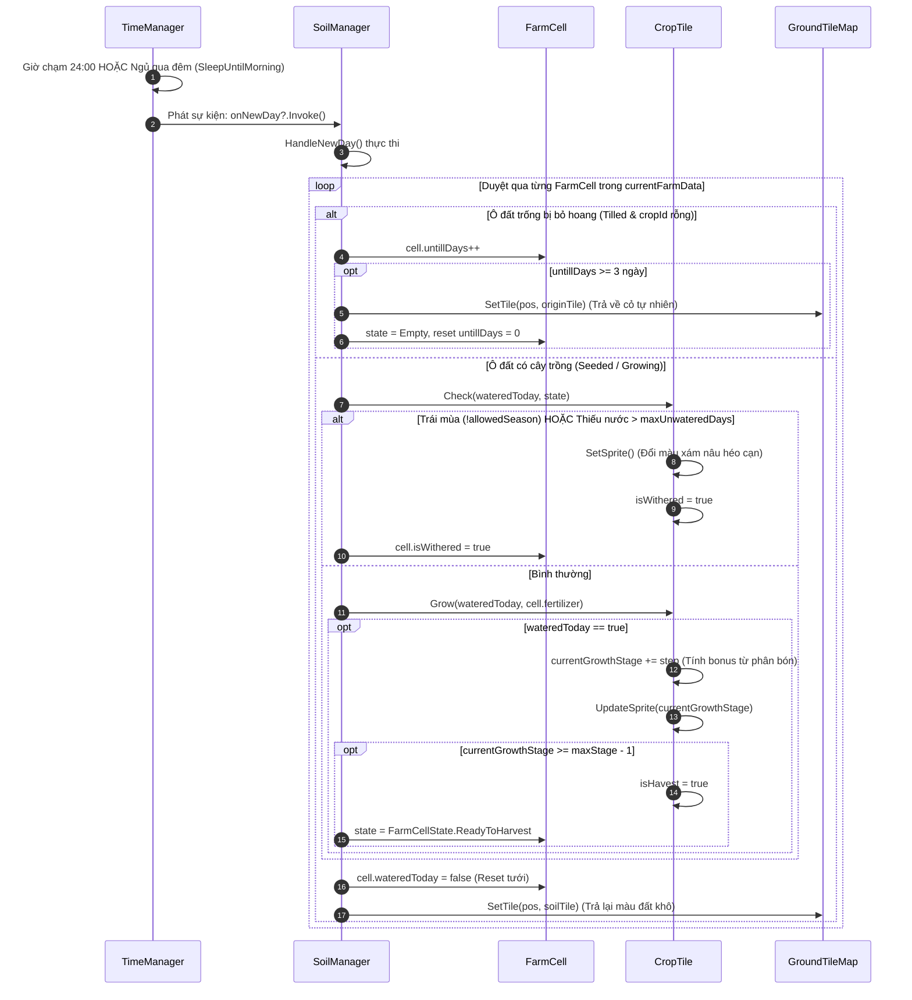
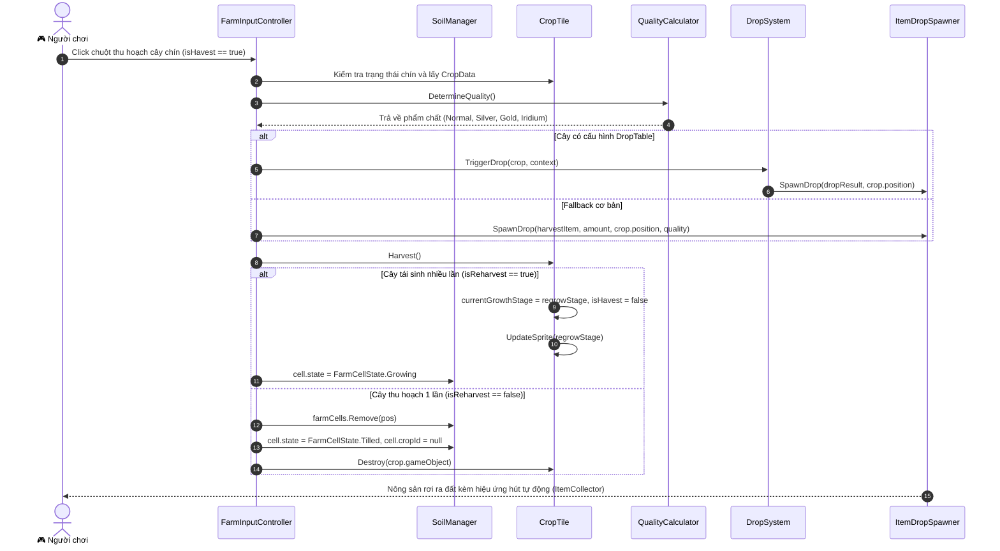
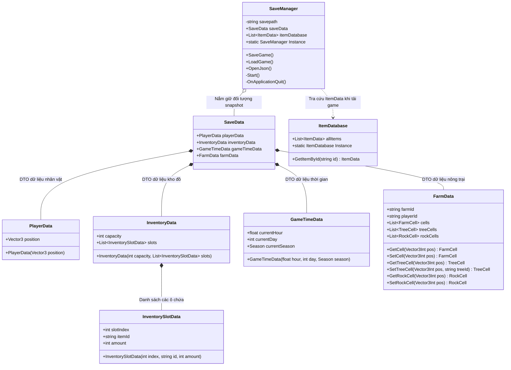
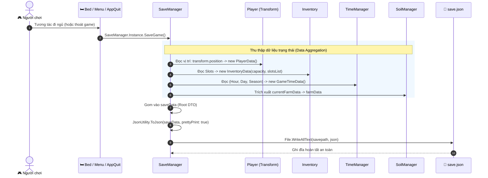
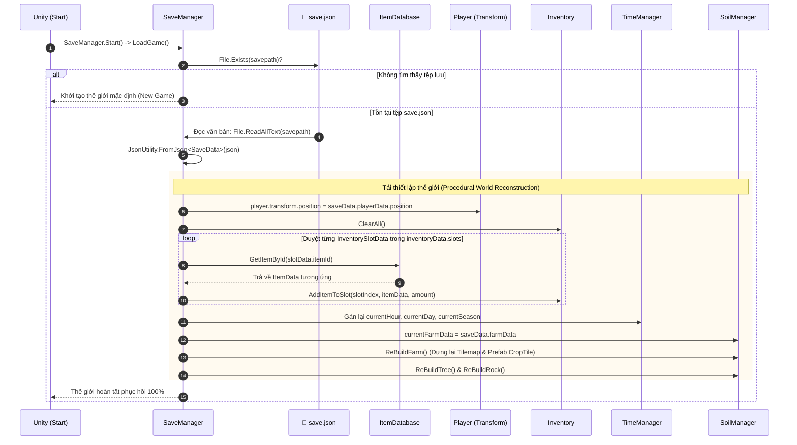

# NỘI DUNG THIẾT KẾ VÀ KẾT QUẢ CÀI ĐẶT CHO BÁO CÁO ĐỒ ÁN TỐT NGHIỆP
**Học phần**: Đồ án Tốt nghiệp (10/2026)  
**Đề tài**: Xây dựng trò chơi nông trại 2D trực tuyến nhiều người chơi  
**Sinh viên thực hiện phụ trách**: Nguyễn Đại Phát — MSSV: B22DCVT393  
**Các mảng phụ trách**: Hệ thống Nhân vật (Player), Chức năng Trồng trọt (Farming System), Hệ thống Lưu trữ và Tải dữ liệu (Save/Load System).

---

# PHẦN 1: THIẾT KẾ HỆ THỐNG (MỤC 3.2, 3.3, 3.4)

## 3.2. THIẾT KẾ NHÂN VẬT (PLAYER)

### 3.2.1. Thiết kế kiến trúc và cấu trúc dữ liệu nhân vật
Hệ thống Nhân vật (`Player`) là trung tâm tiếp nhận tương tác của người chơi, chịu trách nhiệm mô phỏng chuyển động vật lý, hoạt ảnh 4 hướng, quản lý năng lượng hoạt động và phân phối thao tác công cụ lên môi trường.

Kiến trúc nhân vật được xây dựng theo mô hình hướng thành phần (Component-Based Architecture) trên Unity, phân tách độc lập giữa các lớp:
1. **Lớp Điều khiển & Vật lý (Movement & Physics Layer)**: [`PlayerMovement.cs`](file:///d:/Game_Project/Totnghiep2026/Assets/Scripts/PlayerMovement.cs) đảm nhận xử lý vector vận tốc dựa trên dữ liệu bàn phím (`Input.GetAxisRaw`) hoặc hướng đi tự động từ hệ thống tìm đường ([`MapNavigator`](file:///d:/Game_Project/Totnghiep2026/Assets/Scripts/MapNavigator.cs)). Chuyển động được đồng bộ thông qua `Rigidbody2D` với chế độ `Interpolate` để triệt tiêu hiện tượng giật khung hình và ngăn ngừa hiện tượng xuyên tường/kẹt vật cản.
2. **Lớp Thể lực & Trạng thái (Stamina & Status Layer)**: [`PlayerStamina.cs`](file:///d:/Game_Project/Totnghiep2026/Assets/Scripts/PlayerStamina.cs) quản lý thanh thể lực cơ sở ($270$ điểm). Mọi thao tác dùng công cụ tiêu hao thể lực theo định mức. Trạng thái nhân vật được mô hình hóa thành 3 mức: Bình thường (`Normal`), Kiệt sức (`Exhausted` - khi stamina $\le 0$, tốc độ di chuyển bị giảm $50\%$) và Ngất xỉu (`Passout` - khi stamina chạm ngưỡng phạt $\le -15$ hoặc thức quá $02:00$ sáng).
3. **Lớp Hoạt ảnh & Trực quan (Animation & Visual Layer)**: Kết hợp `Animator` 2D Blend Tree với `SpriteRenderer`. Sprite nhân vật tự động cập nhật Sorting Order theo trục $Y$ (`Transparency Sort Mode: Custom Axis (0, 1, 0)`), đảm bảo hiển thị đúng chiều sâu khi đứng trước/sau cây cối và công trình.

#### Sơ đồ lớp (Class Diagram) - Hệ thống Nhân vật (Player System)


### 3.2.2. Thiết kế các chức năng xử lý và tương tác nhân vật
Hệ thống cung cấp các nhóm chức năng cốt lõi sau:
- **Di chuyển 4/8 hướng mượt mà**: Chuẩn hóa vector vận tốc $\vec{v}_{norm} = \frac{\vec{v}}{\|\vec{v}\|}$ để vận tốc di chuyển chéo không bị nhanh hơn đi thẳng; lưu giữ hướng nhìn mặt cuối cùng (`lastDirection`) để nhân vật luôn quay đúng hướng khi dừng lại (`Idle`).
- **Khoanh vùng tác động trên lưới (Grid Targeting & Highlighting)**: [`FarmInputController.cs`](file:///d:/Game_Project/Totnghiep2026/Assets/Scripts/FarmInputController.cs) tính toán tọa độ ô đất phía trước nhân vật hoặc tại con trỏ chuột, hỗ trợ thuật toán bù khoảng cách (`Smart Targeting Offset`) để người chơi không bị trượt click khi thao tác cuốc đất hoặc tưới nước.
- **Phối hợp công cụ và khóa hành động hai chiều**: Khi vung công cụ (Cuốc, Bình tưới, Rìu, Cúp) hoặc câu cá, nhân vật tự động khóa chuyển động vật lý (`isUsingHoe = true`, vận tốc gán về $0$). Hoạt ảnh thực thi đến khung hình va chạm sẽ phát sự kiện `Animation Event` để áp dụng tác động lên ô đất/cây cối và tự động mở khóa di chuyển ngay sau khi hoàn tất.

#### Sơ đồ tuần tự (Sequence Diagram 3.1) - Di chuyển và Điều phối Thể lực


#### Sơ đồ tuần tự (Sequence Diagram 3.2) - Sử dụng Công cụ Canh tác và Hoạt ảnh 2 chiều


---

## 3.3. THIẾT KẾ CHỨC NĂNG TRỒNG TRỌT

### 3.3.1. Thiết kế kiến trúc và cấu trúc dữ liệu hệ thống trồng trọt
Hệ thống Trồng trọt (Farming System) đóng vai trò là hạt nhân của vòng lặp gameplay sản xuất kinh tế. Hệ thống được tổ chức theo kiến trúc phân tách rõ ràng giữa Dữ liệu cấu hình tĩnh, Dữ liệu trạng thái động và Lớp hiển thị Tilemap:
1. **Dữ liệu cấu hình tĩnh (Data-Driven)**: Sử dụng [`CropData`](file:///d:/Game_Project/Totnghiep2026/Assets/Scripts/Crop/CropData.cs) kế thừa `ScriptableObject` để định nghĩa thông số sinh học của từng giống cây: mã `id`, tên, thời gian lớn (`growthTime`), mảng sprite qua từng giai đoạn (`stageSprites`), mùa vụ thích hợp (`allowedSeason`), số ngày chịu khát tối đa (`maxUnwateredDays`), cờ thu hoạch nhiều lần (`isReharvest`) và bảng rơi vật phẩm (`DropTable`).
2. **Dữ liệu trạng thái ô đất runtime**: Lớp [`FarmCell`](file:///d:/Game_Project/Totnghiep2026/Assets/Scripts/Cell/FarmCell.cs) lưu trữ trạng thái của từng tọa độ ô lưới `Vector3Int` gồm: cờ trạng thái (`FarmCellState`: `Empty`, `Tilled`, `Seeded`, `Growing`, `ReadyToHarvest`), cờ đã tưới hôm nay (`wateredToday`), số ngày đã lớn (`growthDays`), loại phân bón đang áp dụng (`FertilizerType`), và số ngày bỏ hoang (`untillDays`).
3. **Lớp hiển thị và Vận hành (Manager & Prefab Layer)**: [`SoilManager.cs`](file:///d:/Game_Project/Totnghiep2026/Assets/Scripts/SoilManager.cs) (Singleton) quản lý các lớp Unity Tilemap (`groundTileMap`, `fertilizerTileMap`) và điều phối danh sách đối tượng [`CropTile`](file:///d:/Game_Project/Totnghiep2026/Assets/Scripts/CropTile.cs) hiển thị trên màn hình.

#### Sơ đồ lớp (Class Diagram) - Hệ thống Trồng trọt (Farming System)


### 3.3.2. Thiết kế các chức năng canh tác và vòng đời sinh trưởng
- **Quy trình làm đất (Tilling)**: Dùng Cuốc (`Hoe`) chuyển đổi mặt đất tự nhiên sang đất canh tác (`soilTile`), ghi nhớ tile gốc (`originTile`) để phục vụ hoàn nguyên khi bỏ hoang.
- **Cơ chế tưới nước và giữ ẩm**: Dùng Bình tưới (`Watering Can`) chuyển bề mặt ô đất sang đất sẫm màu (`soilWetTile`) và bật cờ `wateredToday = true`. Hệ thống hỗ trợ các loại phân bón giữ ẩm ([`FertilizerManager`](file:///d:/Game_Project/Totnghiep2026/Assets/Scripts/FertilizerManager.cs)) với tỉ lệ giữ nước qua đêm ($33\%$ đến $100\%$).
- **Vòng lặp sinh trưởng dựa trên sự kiện (Event-Driven Crop Growth)**: Đất canh tác không tính toán thời gian trong vòng `Update()` mà đăng ký lắng nghe sự kiện `onNewDay` từ [`TimeManager`](file:///d:/Game_Project/Totnghiep2026/Assets/Scripts/TimeManager.cs). Cây chỉ lớn thêm 1 giai đoạn nếu hôm trước đã được tưới nước.
- **Cơ chế héo chết do thiếu nước hoặc trái mùa**: Nếu cây không được tưới vượt quá `maxUnwateredDays` hoặc khi bước sang mùa mới không thuộc danh sách `allowedSeason`, cây sẽ bị héo khô (`isWithered = true`), đổi màu hiển thị sang sắc tố nâu xám và ngừng phát triển.
- **Cơ chế tự động hoang hóa đất (Auto Untill Degradation)**: Các ô đất đã xới nhưng bỏ trống không gieo hạt quá $3$ ngày (`untillDays >= 3`) sẽ tự động lấp lại về địa hình cỏ/đất tự nhiên ban đầu theo bảng tra cứu mùa vụ (`SeasonTileSet`).
- **Thu hoạch và Tính phẩm cấp nông sản**: Khi chín, người chơi thu hoạch bằng Liềm hoặc tay không. Hệ thống tính toán ngẫu nhiên phẩm chất (Bình thường, Bạc, Vàng, Sao) qua [`QualityCalculator`](file:///d:/Game_Project/Totnghiep2026/Assets/Scripts/QualityCalculator.cs) và kích hoạt [`DropSystem`](file:///d:/Game_Project/Totnghiep2026/Assets/Scripts/Drops/DropSystem.cs) văng nông sản ra đất kèm cơ chế hút đồ tự động. Cây có cờ `isReharvest` sẽ tự động chuyển về giai đoạn quả non (`regrowStage`) để tiếp tục vụ sau.

#### Sơ đồ tuần tự (Sequence Diagram 3.3) - Gieo Hạt và Tưới Nước Hàng Ngày


#### Sơ đồ tuần tự (Sequence Diagram 3.4) - Chuyển Ngày Mới và Cây Sinh Trưởng (Event-Driven onNewDay)


#### Sơ đồ tuần tự (Sequence Diagram 3.5) - Thu Hoạch Nông Sản, Tính Phẩm Chất và Tái Sinh


---

## 3.4. THIẾT KẾ HỆ THỐNG LƯU TRỮ VÀ TẢI DỮ LIỆU

### 3.4.1. Thiết kế kiến trúc và mô hình dữ liệu tuần tự hóa
Hệ thống Lưu trữ và Tải dữ liệu (`Save & Load`) được thiết kế nhằm bảo toàn trọn vẹn trạng thái của người chơi và thế giới nông trại giữa các phiên chơi.

1. **Nguyên lý Thu thập tập hợp (Data Aggregation Pattern)**: Hệ thống sử dụng một lớp DTO tổng hợp duy nhất là [`SaveData.cs`](file:///d:/Game_Project/Totnghiep2026/Assets/Scripts/SaveData.cs). Khi thực hiện lưu game, [`SaveManager.cs`](file:///d:/Game_Project/Totnghiep2026/Assets/Scripts/SaveManager.cs) đứng ra trích xuất dữ liệu phân tán từ các hệ thống:
   - `playerData`: Tọa độ vị trí (`Vector3 position`).
   - `inventoryData`: Sức chứa balo (`capacity`) và danh sách các ô đồ (`slotIndex`, `itemId`, `amount`).
   - `gameTimeData`: Giờ hiện tại, ngày và mùa vụ (`currentSeason`).
   - `farmData`: Danh sách trạng thái tất cả các ô đất (`cells`), cây gỗ (`treeCells`), mỏ đá (`rockCells`).
2. **Kỹ thuật tuần tự hóa nhẹ (Lightweight Serialization)**: Thay vì lưu toàn bộ đối tượng đồ họa phức tạp trong Scene, hệ thống chỉ lưu các kiểu dữ liệu nguyên thủy (Primitive Types) và ID chuỗi (`itemId`, `cropId`, `treeId`). Chuỗi dữ liệu được chuyển đổi qua JSON thông qua Unity `JsonUtility` và lưu xuống đường dẫn độc lập nền tảng `Application.persistentDataPath/save.json`.

#### Sơ đồ lớp (Class Diagram) - Hệ thống Lưu trữ và Tải dữ liệu (Save/Load System)


### 3.4.2. Thiết kế các chức năng lưu, tải và tái thiết lập thế giới
- **Cơ chế tự động lưu (Auto-Save Triggers)**: Lưu game tự động diễn ra khi người chơi thực hiện hành vi ngủ trên giường chuyển ngày (`Bed.cs`) hoặc khi thoát ứng dụng (`OnApplicationQuit`).
- **Quy trình nạp dữ liệu (Load Sequence)**: Khi khởi động game hoặc load lại Scene nông trại, [`SaveManager`](file:///d:/Game_Project/Totnghiep2026/Assets/Scripts/SaveManager.cs) đọc file `save.json`, giải mã JSON thành thực thể `SaveData`.
- **Tái thiết lập thế giới thủ tục (Procedural World Reconstruction)**:
  - Khôi phục vị trí nhân vật về đúng tọa độ đã lưu.
  - Xóa sạch túi đồ và tái tạo các ô vật phẩm bằng cách tra cứu ID thông qua [`ItemDatabase`](file:///d:/Game_Project/Totnghiep2026/Assets/Scripts/ItemDatabase.cs).
  - Đồng bộ lại đồng hồ và ánh sáng ngày đêm theo thời gian lưu.
  - Gọi [`SoilManager.Instance.ReBuildFarm()`](file:///d:/Game_Project/Totnghiep2026/Assets/Scripts/SoilManager.cs#L41) để vẽ lại toàn bộ Tilemap đất khô/ẩm và sinh lại các Prefab cây trồng với đúng sprite giai đoạn phát triển tương ứng.

#### Sơ đồ tuần tự (Sequence Diagram 3.6) - Quy trình Lưu Dữ Liệu Game (Save Workflow)


#### Sơ đồ tuần tự (Sequence Diagram 3.7) - Quy trình Nạp & Tái Thiết Lập Thế Giới (Load Workflow)


---


# PHẦN 2: KẾT QUẢ CÀI ĐẶT THỰC NGHIỆM (MỤC 3.15)

---

## 3.15.1. NHÂN VẬT (PLAYER)

### a. Di chuyển nhân vật

Hệ thống di chuyển của nhân vật được quản lý bởi lớp [`PlayerMovement.cs`](file:///d:/Game_Project/Totnghiep2026/Assets/Scripts/PlayerMovement.cs), phối hợp giữa lớp vật lý (`Rigidbody2D`) và lớp hoạt ảnh (`Animator`).

*(Chèn Hình 3.1: Nhân vật di chuyển 4 hướng trên bản đồ nông trại)*

**Giao diện (UI):** Nhân vật hiển thị hoạt ảnh đi bộ 4 hướng (Trái/Phải/Lên/Xuống) thông qua `Animator Blend Tree 2D`. Sorting Order của `SpriteRenderer` cập nhật theo trục Y, đảm bảo nhân vật hiển thị đúng chiều sâu phía trước/sau cây cối và công trình.

**Xử lý logic (Backend):** Đọc trục `Input.GetAxisRaw("Horizontal/Vertical")`, chuẩn hóa vector $\vec{d} = (x, y).\text{normalized}$ và cập nhật vị trí qua `rb.MovePosition()` tại `FixedUpdate()`. Biến `lastDirection` ghi nhớ hướng nhìn cuối để giữ đúng Idle khi người chơi thả phím.

**Bảng 3.1: Tham số cốt lõi điều khiển di chuyển nhân vật**

| Tham số | Kiểu | Giá trị | Vai trò |
|---|---|---|---|
| `moveSpeed` | `float` | $8.0$ | Vận tốc di chuyển cơ sở. |
| `rb` (Rigidbody2D) | Component | `Dynamic, Gravity=0, Interpolate` | Điều khiển chuyển động vật lý, khử giật khung hình. |
| `lastDirection` | `Vector2` | `Vector2.down` | Giữ hướng quay mặt khi nhân vật dừng lại (Idle). |
| Cờ khóa hành động | `bool` | `isUsingHoe`, `isUsingWater`, `isSleeping`... | Khóa vận tốc về $0$ khi đang vung công cụ hoặc ngủ. |

```csharp
// PlayerMovement.cs — Vòng lặp Update và FixedUpdate
void Update()
{
    if (isUsingHoe || isUsingWater || isSleeping) {
        moveDirection = Vector2.zero;
        anim.SetFloat("Speed", 0f);
        return;
    }
    moveDirection = new Vector2(Input.GetAxisRaw("Horizontal"),
                                Input.GetAxisRaw("Vertical")).normalized;
    if (moveDirection != Vector2.zero) lastDirection = moveDirection;
    anim.SetFloat("MoveX", lastDirection.x);
    anim.SetFloat("MoveY", lastDirection.y);
    anim.SetFloat("Speed", moveDirection.sqrMagnitude);
}
private void FixedUpdate() {
    if (isUsingHoe || isUsingWater || isSleeping) return;
    rb.MovePosition(rb.position + moveDirection * moveSpeed * Time.fixedDeltaTime);
}
```

---

### b. Hoạt ảnh và thao tác công cụ

*(Chèn Hình 3.2: Nhân vật thực hiện hoạt ảnh cuốc đất — trạng thái Hoe)*

**Giao diện (UI):** Khi người chơi click chuột trái dùng công cụ (Cuốc, Bình tưới, Rìu, Cúp), `Animator` ngay lập tức chuyển sang State tương ứng. Hệ thống ô viền sáng (`Tile Highlight`) vẽ viền **xanh lá** nếu ô đất hợp lệ, **đỏ** nếu không thể thao tác để người chơi nhận biết trước khi click.

**Xử lý logic (Backend):** [`FarmInputController`](file:///d:/Game_Project/Totnghiep2026/Assets/Scripts/FarmInputController.cs) xác định ô lưới mục tiêu, gọi `TryUseHoe()` để khóa di chuyển (`isUsingHoe = true`) và bắn Trigger `UseHoe` vào Animator. Khi clip hoạt ảnh chạm khung hình va chạm, `Animation Event` gọi ngược về `OnHoeAnimationComplete()`, kích hoạt logic thay đổi ô đất trên `SoilManager`, sau đó mở khóa di chuyển (`isUsingHoe = false`).

**Bảng 3.2: Animator Parameter điều khiển hoạt ảnh nhân vật**

| Parameter | Kiểu | Nguồn cập nhật | Ý nghĩa |
|---|---|---|---|
| `MoveX`, `MoveY` | `Float` | `lastDirection` | Điều khiển Blend Tree hướng nhìn 4 chiều. |
| `Speed` | `Float` | `moveDirection.sqrMagnitude` | Chuyển đổi giữa Idle ($=0$) và Walk ($>0$). |
| `UseHoe`, `UseWater`, `UseAxe` | `Trigger` | `FarmInputController` | Kích hoạt clip hoạt ảnh thao tác công cụ. |

---

### c. Hệ thống thể lực (Stamina)

*(Chèn Hình 3.3: Thanh thể lực trên HUD giảm dần khi người chơi sử dụng công cụ)*

**Giao diện (UI):** Thanh thể lực hiển thị trên Canvas HUD, cập nhật theo thời gian thực. Khi thể lực $\le 0$ (Exhausted) hiển thị cảnh báo và tốc độ nhân vật giảm xuống còn $50\%$. Khi $\le -15$ (Passout) màn hình tối dần, nhân vật ngất xỉu và tự động chuyển sang sáng hôm sau.

**Xử lý logic (Backend):** [`PlayerStamina.cs`](file:///d:/Game_Project/Totnghiep2026/Assets/Scripts/PlayerStamina.cs) quản lý thanh thể lực tối đa $270$ điểm. Mỗi lần dùng công cụ trừ $-2$ stamina. Khi trạng thái thay đổi, sự kiện `onStateStaminaChanged` phát ra để `PlayerMovement` điều chỉnh tốc độ và `UIManager` kích hoạt hiệu ứng màn hình.

```csharp
// PlayerStamina.cs
public void ConsumeStamina(float amount) {
    currentStamina -= amount;
    onStaminaChanged?.Invoke(currentStamina, max);          // Cập nhật UI
    if (currentStamina <= -15f) {
        statePlayer = state.passout;
        UIManager.Instance.TriggerPassOutSleep();            // Fade-out màn hình
    } else if (currentStamina <= 0f) {
        statePlayer = state.exhausted;
        onStateStaminaChanged?.Invoke(statePlayer);          // Giảm 50% tốc độ
    }
}
```

---

## 3.15.2. CHỨC NĂNG TRỒNG TRỌT (FARMING SYSTEM)

### a. Xới đất và tưới nước

*(Chèn Hình 3.4: Ô đất khô sau khi cuốc — Hình 3.5: Ô đất ẩm sau khi tưới nước)*

**Giao diện (UI):**
- **Xới đất:** Ô đất chuyển ngay lập tức sang tile bề mặt đất nâu khô (`soilTile`).
- **Tưới nước:** Tile đổi sang màu đất sẫm ướt (`soilWetTile`) xác nhận độ ẩm trong ngày.
- Lớp `fertilizerTileMap` phủ biểu tượng loại phân bón đang sử dụng lên ô đất.

**Xử lý logic (Backend):** [`SoilManager`](file:///d:/Game_Project/Totnghiep2026/Assets/Scripts/SoilManager.cs) là Singleton trung tâm quản lý dữ liệu ô đất và Tilemap. Khi xới, `FarmCell` khởi tạo với `state = Tilled` và ghi nhớ `originTile` để khôi phục đất hoang sau $3$ ngày bỏ trống. Khi tưới, `cell.wateredToday = true` và Tilemap cập nhật ngay sang `soilWetTile`.

**Bảng 3.3: Thành phần kỹ thuật cốt lõi xới đất và tưới nước**

| Thành phần | Thuộc tính / Phương thức | Vai trò |
|---|---|---|
| `SoilManager` | `Tilled()`, `WaterSoil()`, `CanWater()` | Cập nhật trạng thái ô đất và tile Tilemap. |
| `FarmCell` | `state`, `wateredToday`, `originTile`, `untillDays` | Lưu trạng thái logic từng ô (`Empty`, `Tilled`, `Seeded`...). |
| `FarmInputController` | `Hoe()`, `Water()`, `isWatering` | Bắt input click chuột, xác định ô mục tiêu, chống spam hành động. |

---

### b. Gieo hạt và sinh trưởng cây trồng

*(Chèn Hình 3.6: Mầm cây Stage 0 sau khi gieo hạt — Hình 3.7: Cây lớn lên qua các giai đoạn)*

**Giao diện (UI):**
- Khi cầm hạt giống, hệ thống hiển thị ô viền sáng **xanh** (đất đã xới) / **đỏ** (không hợp lệ) theo thời gian thực để gợi ý vị trí gieo.
- Khi gieo, Prefab [`CropTile`](file:///d:/Game_Project/Totnghiep2026/Assets/Scripts/CropTile.cs) được sinh ra, `SpriteRenderer` hiển thị Sprite theo mảng `stageSprites` trong `CropData` — tự động cập nhật sang giai đoạn tiếp theo mỗi ngày khi đủ điều kiện.

**Xử lý logic (Backend):** Thông số giống cây được đóng gói trong [`CropData`](file:///d:/Game_Project/Totnghiep2026/Assets/Scripts/Crop/CropData.cs) (`ScriptableObject`) — mã định danh, số giai đoạn, mùa vụ thích hợp, giới hạn ngày không tưới. [`SoilManager`](file:///d:/Game_Project/Totnghiep2026/Assets/Scripts/SoilManager.cs) lắng nghe sự kiện `onNewDay` từ [`TimeManager`](file:///d:/Game_Project/Totnghiep2026/Assets/Scripts/TimeManager.cs) — cây chỉ lớn thêm 1 bậc khi `wateredToday == true`. Phân bón tốc độ ([`FertilizerManager`](file:///d:/Game_Project/Totnghiep2026/Assets/Scripts/FertilizerManager.cs)) thêm tỉ lệ nhảy bậc ngẫu nhiên.

**Bảng 3.4: Cấu hình dữ liệu CropData mẫu — Cây Cà rốt (Carrot)**

| Trường | Kiểu | Giá trị | Ý nghĩa |
|---|---|---|---|
| `id` | `string` | `"001"` | Mã tra cứu khi lưu/tải JSON. |
| `maxStage` | `int` | $5$ | Tổng số nấc sinh trưởng đến chín. |
| `allowedSeason` | `List<Season>` | `Spring, Summer` | Mùa hợp lệ; trái mùa → héo ngay. |
| `maxUnwateredDays` | `int` | $2$ | Số ngày chịu khát tối đa trước khi chết. |
| `isReharvest` | `bool` | `false` | `true` = tái sinh sau thu hoạch. |

```csharp
// CropTile.cs — Sinh trưởng mỗi ngày mới
public void Grow(bool isWatered, FertilizerType fertilizer) {
    if (!isWatered || currentGrowthStage >= cropData.maxStage - 1) return;
    int step = 1;
    if (Random.value <= FertilizerManager.GetSpeedBonus(fertilizer)) step++;
    currentGrowthStage = Mathf.Min(currentGrowthStage + step, cropData.maxStage - 1);
    UpdateSprite(currentGrowthStage);                        // Đổi Sprite UI
    if (currentGrowthStage >= cropData.maxStage - 1) isHavest = true;
}
```

---

### c. Thu hoạch, phẩm chất và kiểm soát mùa vụ

*(Chèn Hình 3.8: Cây chín sẵn sàng thu hoạch — Hình 3.9: Cây héo chết khi trái mùa)*

**Giao diện (UI):**
- **Thu hoạch:** Khi cây đạt `isHavest = true`, nông sản văng ra đất dưới dạng `WorldItem` với hiệu ứng hút tự động vào túi đồ (`ItemCollector`).
- **Héo chết:** Khi sai mùa hoặc thiếu nước quá ngưỡng, màu tint của `SpriteRenderer` đổi sang `Color(0.5f, 0.4f, 0.3f, 1f)` (xám nâu héo) mà không cần thêm file Sprite mới.
- **Đất hoang hóa:** Sau $3$ ngày bỏ trống, ô đất tự hoàn nguyên về tile cỏ tự nhiên đúng màu mùa vụ hiện tại.

**Xử lý logic (Backend):** Khi thu hoạch, [`QualityCalculator`](file:///d:/Game_Project/Totnghiep2026/Assets/Scripts/QualityCalculator.cs) tính phẩm chất ngẫu nhiên (`Normal` $1.0\times$, `Silver` $1.25\times$, `Gold` $1.5\times$, `Iridium` $2.0\times$), sau đó [`DropSystem`](file:///d:/Game_Project/Totnghiep2026/Assets/Scripts/Drops/DropSystem.cs) kích hoạt sinh vật phẩm. Cây `isReharvest = true` reset về `regrowStage` thay vì bị hủy. Khi mùa đổi, `CropTile.Check()` đối chiếu `currentSeason` với `allowedSeason` — trái mùa gán `isWithered = true` ngay lập tức.

```csharp
// CropTile.cs — Kiểm tra mùa vụ và thiếu nước mỗi ngày mới
public void Check(bool isWatered, FarmCellState state) {
    if (!cropData.allowedSeason.Contains(TimeManager.Instance.currentSeason)) {
        SetSprite(); isWithered = true; return;   // Trái mùa → héo ngay
    }
    if (!isWatered && state != FarmCellState.Tilled) {
        if (++unWateredDay > cropData.maxUnwateredDays) {
            SetSprite(); isWithered = true;        // Thiếu nước → héo chết
        }
    } else { unWateredDay = 0; }
}
public void SetSprite() {
    spriteRenderer.color = new Color(0.5f, 0.4f, 0.3f, 1f); // Đổi màu UI héo
}
```

---

## 3.15.3. HỆ THỐNG LƯU TRỮ VÀ TẢI DỮ LIỆU (SAVE/LOAD)

### a. Lưu dữ liệu game

*(Chèn Hình 3.10: Người chơi tương tác với Giường để kích hoạt lưu game qua đêm)*

**Giao diện (UI):**
- Lưu game được kích hoạt khi người chơi **tương tác với Giường** (`Bed.cs`) để ngủ qua đêm — màn hình Fade-out, hệ thống chốt toàn bộ dữ liệu tiến trình trong ngày.
- Lưu game cũng tự động diễn ra khi **thoát ứng dụng** (`OnApplicationQuit`) để tránh mất dữ liệu.

**Xử lý logic (Backend):** [`SaveManager`](file:///d:/Game_Project/Totnghiep2026/Assets/Scripts/SaveManager.cs) (Singleton) thu thập dữ liệu từ 4 hệ thống vào đối tượng DTO trung tâm [`SaveData`](file:///d:/Game_Project/Totnghiep2026/Assets/Scripts/SaveData.cs), sau đó tuần tự hóa JSON bằng `JsonUtility.ToJson()` và ghi xuống `Application.persistentDataPath/save.json`.

**Bảng 3.5: Lược đồ dữ liệu tuần tự hóa trong tệp save.json**

| Khối DTO | Trường dữ liệu cốt lõi | Nguồn thu thập |
|---|---|---|
| `playerData` | `position (Vector3)` | `Player.transform.position` |
| `inventoryData` | `capacity`, `slots[ ]` (slotIndex, itemId, amount) | `Inventory.Instance.Slots` |
| `gameTimeData` | `currentHour`, `currentDay`, `currentSeason` | `TimeManager.Instance` |
| `farmData` | `cells[ ]` (position, state, wateredToday, cropId, growthDays, fertilizer, isWithered) | `SoilManager.Instance.currentFarmData` |

```csharp
// SaveManager.cs — SaveGame()
public void SaveGame() {
    saveData.playerData    = new PlayerData(GameObject.FindWithTag("Player").transform.position);
    saveData.inventoryData = /* Duyệt Inventory.Instance.Slots → InventorySlotData */
    saveData.gameTimeData  = new GameTimeData(TimeManager.Instance.currentHour,
                                              TimeManager.Instance.currentDay,
                                              TimeManager.Instance.currentSeason);
    saveData.farmData      = SoilManager.Instance.currentFarmData;
    File.WriteAllText(savepath, JsonUtility.ToJson(saveData, true));
}
```

---

### b. Tải và tái thiết lập thế giới game

*(Chèn Hình 3.11: Cấu trúc tệp save.json lưu trữ dữ liệu nhân vật, túi đồ, thời gian và nông trại)*

**Giao diện (UI):** Sau khi `LoadGame()` hoàn tất, toàn bộ giao diện được phục hồi đồng bộ:
- Vị trí nhân vật, hướng nhìn được khôi phục ngay.
- `HotbarUI` và `InventoryUI` vẽ lại đúng icon và số lượng vật phẩm.
- Kim đồng hồ trên HUD và hệ thống `Global Light 2D` nội suy đúng theo giờ và mùa vụ đã lưu.
- Toàn bộ ô đất nông trại (tile ướt/khô, Prefab cây trồng đúng giai đoạn) được dựng lại hoàn chỉnh.

**Xử lý logic (Backend):** Khi khởi động Scene (`Start()`), `LoadGame()` kiểm tra `File.Exists(savepath)`. Nếu tồn tại, giải mã JSON thành `SaveData` và thực hiện **Procedural World Reconstruction**:
1. Gán lại `player.transform.position`.
2. Xóa túi đồ (`ClearAll`) → tra cứu `ItemDatabase.GetItemById(itemId)` → cấp phát vật phẩm vào đúng slot.
3. Đồng bộ `TimeManager` (giờ, ngày, mùa).
4. Gán `SoilManager.currentFarmData = saveData.farmData` → gọi `ReBuildFarm()` để tái tạo Tilemap và Prefab `CropTile` với đúng Sprite giai đoạn đã lưu.

```csharp
// SaveManager.cs — LoadGame()
public void LoadGame() {
    if (!File.Exists(savepath)) return;
    saveData = JsonUtility.FromJson<SaveData>(File.ReadAllText(savepath));

    // 1. Khôi phục vị trí nhân vật
    GameObject.FindWithTag("Player").transform.position = saveData.playerData.position;

    // 2. Khôi phục túi đồ
    Inventory.Instance.ClearAll();
    foreach (var slot in saveData.inventoryData.slots) {
        ItemData data = ItemDatabase.Instance.GetItemById(slot.itemId);
        if (data != null) Inventory.Instance.AddItemToSlot(slot.slotIndex, data, slot.amount);
    }

    // 3. Khôi phục thời gian
    TimeManager.Instance.currentHour   = saveData.gameTimeData.currentHour;
    TimeManager.Instance.currentDay    = saveData.gameTimeData.currentDay;
    TimeManager.Instance.currentSeason = saveData.gameTimeData.currentSeason;

    // 4. Tái thiết lập thế giới nông trại
    SoilManager.Instance.currentFarmData = saveData.farmData;
    SoilManager.Instance.ReBuildFarm();
    SoilManager.Instance.ReBuildTree();
    SoilManager.Instance.ReBuildRock();
}
```

**Điểm sáng kỹ thuật:**
- **Lightweight Serialization:** Chỉ lưu string ID và primitive types — tệp `save.json` nhỏ gọn chỉ $10$–$40\text{ KB}$, tải nhanh và không phụ thuộc phiên bản ScriptableObject.
- **Procedural Reconstruction:** Không lưu `GameObject` Unity trực tiếp; thay vào đó hệ thống đọc dữ liệu logic và tái tạo toàn bộ thế giới qua `ReBuildFarm()` — đảm bảo khôi phục $100\%$ chính xác trạng thái trước khi thoát.
