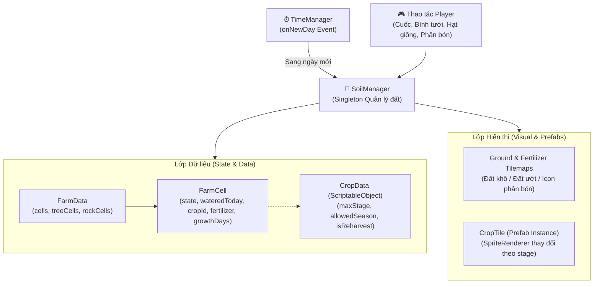
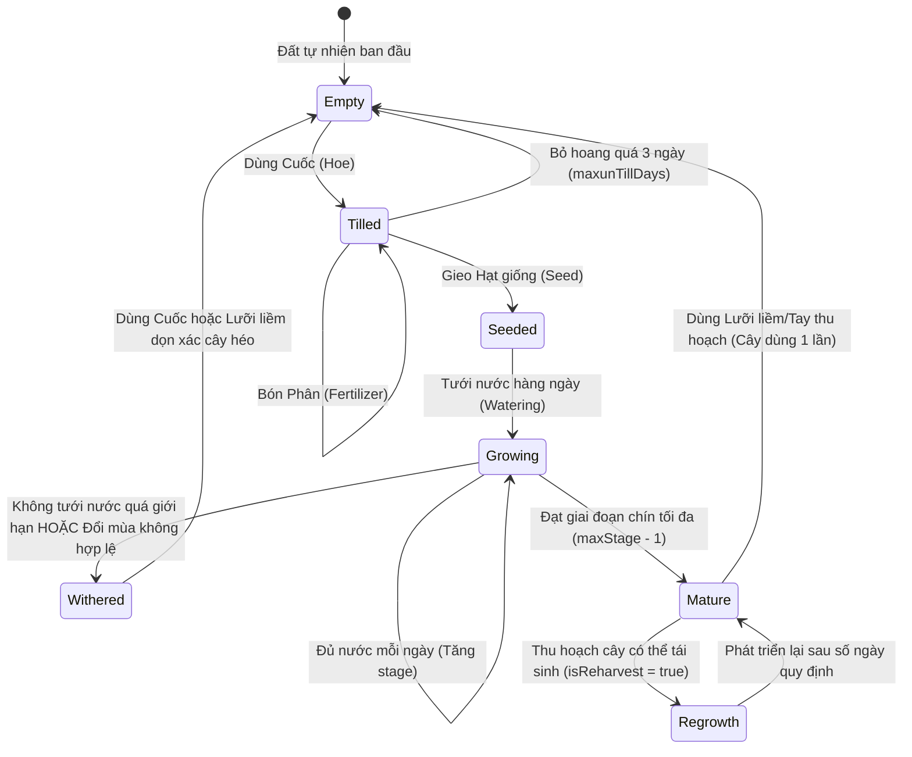

# Tài liệu Thiết kế Kỹ thuật: Hệ thống Trồng trọt & Nông trại (Farming System)

> **Dự án**: Farm RPG (Totnghiep2026)  
> **Thành phần**: Nông nghiệp (Đất đai, Cây trồng, Mùa vụ, Phân bón, Thu hoạch & Phẩm chất)  
> **Tài liệu liên quan**: [Player System](file:///d:/Game_Project/Totnghiep2026/docs/player_design.md) | [Save & Load System](file:///d:/Game_Project/Totnghiep2026/docs/save_load_design.md) | [Tổng quan docs](file:///d:/Game_Project/Totnghiep2026/docs/README.md)

---

## 1. Tổng quan kiến trúc (Architectural Overview)

Hệ thống Trồng trọt là trụ cột cốt lõi của trò chơi. Hệ thống kết hợp giữa **Unity 2D Tilemap** (thể hiện bề mặt đất, độ ẩm và lớp phủ phân bón) và các **GameObject Runtime** ([`CropTile`](file:///d:/Game_Project/Totnghiep2026/Assets/Scripts/CropTile.cs)) để hiển thị quá trình phát triển trực quan từng giai đoạn của cây trồng.



---

## 2. Các thành phần mã nguồn cốt lõi (Core Components)

| Class / Enum | File Source | Chức năng chính |
|---|---|---|
| [`SoilManager`](file:///d:/Game_Project/Totnghiep2026/Assets/Scripts/SoilManager.cs) | `Assets/Scripts/SoilManager.cs` | Quản lý toàn bộ ô đất trên Grid, lắng nghe sự kiện qua ngày, cập nhật Tilemap và sinh cây trồng. |
| [`FarmCell`](file:///d:/Game_Project/Totnghiep2026/Assets/Scripts/Cell/FarmCell.cs) | `Assets/Scripts/Cell/FarmCell.cs` | Lưu trữ trạng thái logic của từng tọa độ ô đất (Đã xới, đã tưới, hạt giống gì, loại phân bón nào). |
| [`FarmCellState`](file:///d:/Game_Project/Totnghiep2026/Assets/Scripts/FarmCellState.cs) | `Assets/Scripts/FarmCellState.cs` | Enum trạng thái ô: `Empty`, `Tilled`, `Seeded`. |
| [`CropTile`](file:///d:/Game_Project/Totnghiep2026/Assets/Scripts/CropTile.cs) | `Assets/Scripts/CropTile.cs` | Component gắn trên Prefab hiển thị cây trồng runtime, xử lý chuyển đổi Sprite theo độ tuổi, thu hoạch, héo úa. |
| [`CropData`](file:///d:/Game_Project/Totnghiep2026/Assets/Scripts/Crop/CropData.cs) | `Assets/Scripts/Crop/CropData.cs` | `ScriptableObject` chứa chỉ số loại cây: số ngày lớn, sprite từng stage, mùa vụ thích hợp, tỉ lệ ra quả lặp lại. |
| [`FertilizerManager`](file:///d:/Game_Project/Totnghiep2026/Assets/Scripts/FertilizerManager.cs) | `Assets/Scripts/FertilizerManager.cs` | Tính toán hiệu ứng tăng tốc sinh trưởng (`Speed-Gro`) và tỉ lệ giữ ẩm qua đêm (`Retaining Soil`). |
| [`QualityCalculator`](file:///d:/Game_Project/Totnghiep2026/Assets/Scripts/QualityCalculator.cs) | `Assets/Scripts/QualityCalculator.cs` | Tính phẩm chất nông sản khi thu hoạch (`Normal`, `Silver`, `Gold`, `Iridium`) và hệ số giá bán. |

---

## 3. Vòng đời Cây trồng (Crop Lifecycle State Machine)



---

## 4. Cơ chế Chi tiết (In-Depth Mechanics)

### 4.1. Cày xới & Thoái hóa đất (Tilling & Untilling)
- Khi dùng Cuốc lên ô đất cỏ hợp lệ (`FarmCellState.Empty`), hệ sinh một [`FarmCell`](file:///d:/Game_Project/Totnghiep2026/Assets/Scripts/Cell/FarmCell.cs) mới với trạng thái `Tilled` và thay tile bề mặt sang `soilTile`.
- **Cơ chế thoái hóa đất**: Nếu ô đất đã xới mà không được gieo hạt, mỗi ngày trôi qua giá trị `untillDays` sẽ tăng thêm 1. Khi `untillDays > maxunTillDays (3 ngày)`, ô đất sẽ biến mất và hoàn nguyên về tile cỏ ban đầu (`originTile`).

### 4.2. Tưới nước & Giữ ẩm qua đêm
- Ô đất chỉ có thể tưới nếu đang ở trạng thái `Tilled` hoặc `Seeded` và chưa được tưới trong ngày (`!cell.wateredToday`).
- Sau khi tưới, Tilemap đổi sang `soilWetTile`.
- Khi qua ngày mới:
  - Kiểm tra loại phân bón giữ ẩm:
    - **Basic Retaining Soil**: $33\%$ cơ hội giữ ẩm hôm sau.
    - **Quality Retaining Soil**: $66\%$ cơ hội giữ ẩm hôm sau.
    - **Deluxe Retaining Soil**: $100\%$ chắc chắn giữ ẩm (không cần tưới lại).
  - Nếu không giữ được ẩm, `cell.wateredToday` reset về `false` và đất chuyển lại sang màu khô.

### 4.3. Tốc độ sinh trưởng & Ảnh hưởng của Phân bón
- Khi qua ngày mới, nếu ô đất **được tưới nước** (`isWatered = true`), cây sẽ tiến thêm giai đoạn:
  $$\text{BonusChance} = \text{FertilizerManager.GetSpeedBonus}(\text{fertilizer})$$
  - **Speed-Gro**: $+10\%$ tỉ lệ nhảy thêm 1 bậc tăng trưởng trong ngày.
  - **Deluxe Speed-Gro**: $+25\%$ tỉ lệ nhảy bậc.
  - **Hyper Speed-Gro**: $+33\%$ tỉ lệ nhảy bậc.
- Nếu người chơi không tưới nước:
  - Cây **không phát triển** (dậm chân tại stage hiện tại).
  - Biến `unWateredDay` tăng lên. Nếu vượt quá `cropData.maxUnwateredDays`, cây sẽ chết khô (`isWithered = true`).

### 4.4. Đổi mùa (Season Transition)
- Mỗi cây trồng quy định danh sách các mùa cho phép phát triển (`cropData.allowedSeason`).
- Khi [`TimeManager`](file:///d:/Game_Project/Totnghiep2026/Assets/Scripts/TimeManager.cs) chuyển sang mùa mới, nếu mùa hiện tại không nằm trong `allowedSeason`, cây trồng sẽ ngay lập tức bị héo khô (`isWithered = true`), trừ một số loại cây đa mùa (như Cà phê, Lúa mì).

### 4.5. Cơ chế Thu hoạch & Phẩm chất Nông sản (Harvest & Quality)
Khi cây chín muồi (`isHavest == true`):
1. **Kiểm tra loại cây**:
   - Cây thu hoạch 1 lần (Củ cải, Khoai tây, Súp lơ): Thu hoạch xong ô đất trở về `Tilled`, prefab cây bị hủy.
   - Cây thu hoạch nhiều đợt (Cà chua, Dâu tây): Cây quay về `regrowStage` và tiếp tục chu kỳ kết trái mới.
2. **Tính toán phẩm chất ([`QualityCalculator`](file:///d:/Game_Project/Totnghiep2026/Assets/Scripts/QualityCalculator.cs))**:
   - **Normal Quality**: Tỉ lệ mặc định ($80\%$). Hệ số giá trị: $1.0\times$.
   - **Silver Quality**: Tỉ lệ $15\%$. Hệ số giá trị: $1.25\times$.
   - **Gold Quality**: Tỉ lệ $5\%$. Hệ số giá trị: $1.5\times$.
   - **Iridium Quality**: Xuất hiện khi dùng Phân bón đặc biệt hoặc cấp độ nông nghiệp cao. Hệ số giá trị: $2.0\times$.
3. **Rơi vật phẩm**: Kích hoạt [`DropSystem`](file:///d:/Game_Project/Totnghiep2026/Assets/Scripts/Drops/DropSystem.cs) để văng nông sản ra sàn đất quanh người chơi kèm hiệu ứng hút đồ tự động ([`ItemCollector`](file:///d:/Game_Project/Totnghiep2026/Assets/Scripts/Drops/ItemCollector.cs)).

---

## 5. Bảng cấu hình dữ liệu mẫu (Data Schema Reference)

### 5.1. Dữ liệu Hạt giống & Cây trồng (`CropData`)
```csharp
[CreateAssetMenu(fileName = "New Crop Data", menuName = "Farming/Crop Data")]
public class CropData : ScriptableObject
{
    public string id;                         // Mã định danh (vd: "crop_parsnip")
    public string cropName;                   // Tên hiển thị (vd: "Parsnip")
    public int maxStage;                      // Tổng số frame tăng trưởng
    public Sprite[] growthSprites;            // Sprite tương ứng từng frame
    public Sprite witheredSprite;             // Sprite khi chết khô
    public List<Season> allowedSeason;        // Mùa có thể sống
    public int maxUnwateredDays;              // Số ngày chịu khát tối đa
    public bool isReharvest;                  // Cây có ra quả nhiều lần không?
    public int regrowStage;                   // Trở lại stage nào sau khi hái
    public ItemData harvestItem;              // Vật phẩm nông sản nhận được
}
```

---

## 6. Hướng phát triển & Đề xuất mở rộng (Future Roadmap)

1. **Hệ thống tưới nước tự động (Sprinkler)**:
   - Các loại vòi phun tưới tự động $3\times 3$ hoặc $5\times 5$ vào mỗi 06:00 sáng mà không tốn công người chơi.
2. **Cây khổng lồ (Giant Crops)**:
   - Khi trồng các loại cây đặc thù (Bí ngô, Súp lơ, Dưa hấu) theo khối $3\times 3$, có $1\%$ tỉ lệ hợp nhất thành một cây khổng lồ cần dùng rìu bổ để thu hoạch nhiều tài nguyên hơn.
3. **Nhà kính (Greenhouse)**:
   - Vùng bản đồ đặc biệt bỏ qua giới hạn mùa vụ của `allowedSeason`, cho phép trồng trọt quanh năm.
