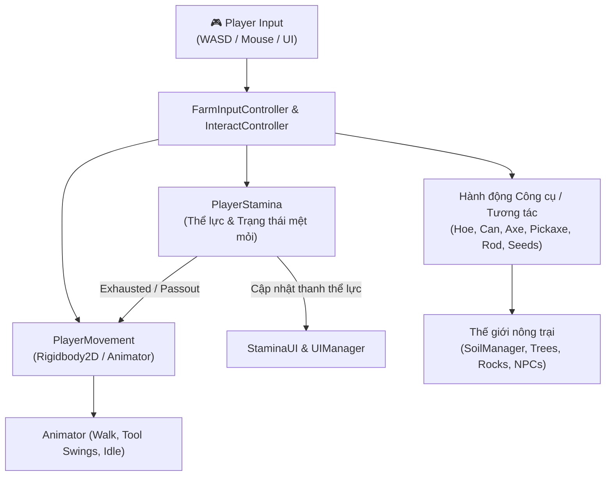
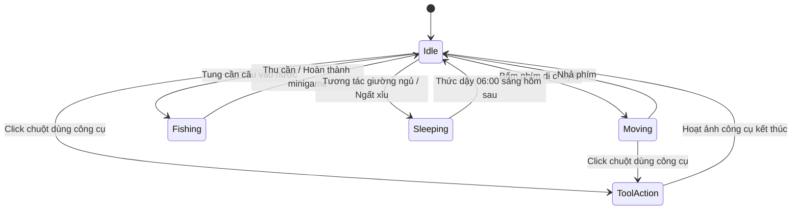
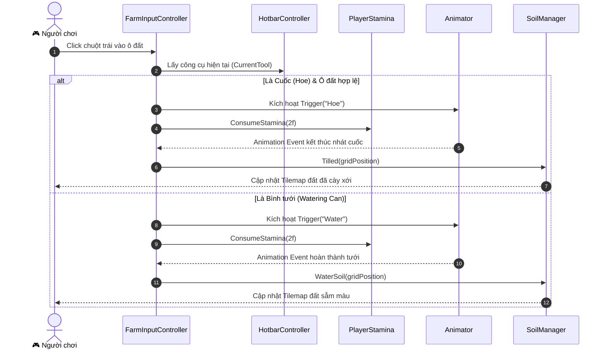

# Tài liệu Thiết kế Kỹ thuật: Hệ thống Nhân vật (Player System)

> **Dự án**: Farm RPG (Totnghiep2026)  
> **Thành phần**: Nhân vật chính (Player Controller, Stamina, Interaction, Animation)  
> **Tài liệu liên quan**: [Farming System](file:///d:/Game_Project/Totnghiep2026/docs/farming_design.md) | [Save & Load System](file:///d:/Game_Project/Totnghiep2026/docs/save_load_design.md) | [Tổng quan docs](file:///d:/Game_Project/Totnghiep2026/docs/README.md)

---

## 1. Tổng quan mục tiêu (System Overview)

Hệ thống Nhân vật (`Player`) là trung tâm tương tác của toàn bộ trò chơi, chịu trách nhiệm tiếp nhận thao tác từ người chơi, phản hồi vật lý, điều khiển trạng thái thể lực (Stamina), quản lý hướng nhìn/hoạt ảnh (Animation) và điều phối các hành động công cụ (cuốc đất, tưới cây, chặt cây, đập đá, câu cá).

---

## 2. Các thành phần mã nguồn cốt lõi (Core Components)

| Tên Class | File Source | Vai trò chính |
|---|---|---|
| [`PlayerMovement`](file:///d:/Game_Project/Totnghiep2026/Assets/Scripts/PlayerMovement.cs) | `Assets/Scripts/PlayerMovement.cs` | Xử lý di chuyển vật lý 2D, tốc độ, khóa di chuyển, điều khiển hoạt ảnh 4 hướng, hỗ trợ tự hành (Auto Move). |
| [`PlayerStamina`](file:///d:/Game_Project/Totnghiep2026/Assets/Scripts/PlayerStamina.cs) | `Assets/Scripts/PlayerStamina.cs` | Quản lý điểm thể lực, trừ thể lực khi thao tác, phát sinh trạng thái kiệt sức (`exhausted`) và ngất xỉu (`passout`). |
| [`FarmInputController`](file:///d:/Game_Project/Totnghiep2026/Assets/Scripts/FarmInputController.cs) | `Assets/Scripts/FarmInputController.cs` | Bắt click chuột, kiểm tra ô mục tiêu trên Grid/Tilemap, kích hoạt hoạt ảnh và gọi logic nông trại. |
| [`InteractController`](file:///d:/Game_Project/Totnghiep2026/Assets/Scripts/InteractController.cs) | `Assets/Scripts/InteractController.cs` | Bắt chuột phải để tương tác với NPC, Rương (`Chest`), Thùng xuất khẩu hàng (`ShippingBin`), Giường ngủ (`Bed`). |
| [`PlayerMoney`](file:///d:/Game_Project/Totnghiep2026/Assets/Scripts/ShopNMoney/PlayerMoney.cs) | `Assets/Scripts/ShopNMoney/PlayerMoney.cs` | Quản lý tiền tệ (Gold) của nhân vật khi mua bán. |
| [`PlayerData`](file:///d:/Game_Project/Totnghiep2026/Assets/Scripts/PlayerData.cs) | `Assets/Scripts/PlayerData.cs` | DTO lưu trữ dữ liệu nhân vật để serialize ra file JSON. |

---

## 3. Cơ chế Di chuyển & Hoạt ảnh (Movement & Animation)

### 3.1. Luồng xử lý di chuyển (Movement Flow)
- **Input**: Nhận trục `Horizontal` và `Vertical` từ bàn phím (hoặc hướng tự động từ thuật toán tìm đường `MapNavigator` thông qua `SetAutoMoveDirection()`). Phím bấm thủ công luôn được ưu tiên cao nhất (`HasManualInput`).
- **Khóa di chuyển (Movement Lock)**: Nhân vật bị khóa di chuyển hoàn toàn khi:
  - Đang vung công cụ: `isUsingHoe`, `isUsingWater`, `isUsingAxe`, `isUsingPickaxe`.
  - Đang câu cá: `FishingController.Instance.IsFishing`.
  - Đang ngủ / chuyển cảnh màn hình đen: `isSleeping`.
- **Hệ số tốc độ (Speed Modifier)**:
  $$\text{CurrentSpeed} = \text{baseSpeed} \times \text{multipleIndex}$$
  - Bình thường (`Normal`): `multipleIndex = 1.0f`.
  - Kiệt sức (`Exhausted`): `multipleIndex = 0.5f` (tốc độ giảm 50%).

### 3.2. Cập nhật Hoạt ảnh 4 hướng
Nhân vật lưu trữ biến `lastDirection` (mặc định ban đầu hướng xuống `Vector2.down`). Khi người chơi di chuyển, giá trị `FacingDirection` cập nhật tương ứng (`Horizontal`, `Vertical`, `Speed`) vào Unity Animator để hiển thị sprite hướng mặt chính xác.

---

## 4. Hệ thống Thể lực (Stamina System)

### 4.1. Thông số và các ngưỡng thể lực
- **Giá trị tối đa**: `max = 270f`.
- **Phân cấp trạng thái**:
  1. **`state.normal`** ($> 0$ stamina): Hoạt động với $100\%$ tốc độ.
  2. **`state.exhausted`** ($\le 0$ stamina): Cảnh báo mệt mỏi, tốc độ di chuyển bị giảm một nửa ($50\%$).
  3. **`state.passout`** ($\le -15f$ stamina hoặc quá 02:00 sáng): Nhân vật ngất xỉu vì kiệt sức, gọi `UIManager.Instance.TriggerPassOutSleep()`.

### 4.2. Mức tiêu thụ thể lực theo công cụ
| Hành động | Lượng thể lực tiêu hao | Ghi chú |
|---|---|---|
| Cuốc đất (Hoe) | $-2.0$ | Khi cuốc thành công ô đất trống |
| Tưới nước (Watering Can) | $-2.0$ | Khi tưới thành công ô đất chưa có nước |
| Chặt cây (Axe) | $-2.0 \sim -3.0$ | Mỗi nhát chém vào thân cây |
| Đập đá (Pickaxe) | $-2.0 \sim -3.0$ | Mỗi nhát đập vào tảng đá |
| Gieo hạt / Bón phân | $0$ (hoặc $-1.0$) | Thao tác nhẹ |
| Câu cá | $-3.0$ | Khi quăng mồi câu |

### 4.3. Cơ chế hồi phục khi ngủ
- **Ngủ bình thường trên giường trước 00:00**: Hồi phục $100\%$ thể lực tối đa ($270f$).
- **Ngủ muộn sau 00:00**: Thể lực hồi theo tỉ lệ giảm dần.
- **Ngất xỉu (Passout)**: Bị phạt phục hồi, hôm sau chỉ bắt đầu với $50\%$ thể lực tối đa ($135f$).

---

## 5. Hệ thống Tương tác & Thao tác Công cụ

### 5.1. Phân bổ phím bấm
- **Chuột trái (`Left Click`)**: Dùng công cụ đang cầm trên tay (Hotbar active slot).
- **Chuột phải (`Right Click`)**: Tương tác thực thể (`IInteractable` như Giương, Cửa, Giường) hoặc giao thương (`ITradeReceiver` như Thùng bán hàng `ShippingBin`, Shop NPC).

---

## 6. Hướng phát triển & Đề xuất mở rộng (Improvements)

1. **Lưu trữ dữ liệu toàn diện trong [`PlayerData`](file:///d:/Game_Project/Totnghiep2026/Assets/Scripts/PlayerData.cs)**:
   - Hiện tại class chỉ lưu `position`.
   - Đề xuất bổ sung: `currentStamina`, `currentGold`, `facingDirection`, `selectedHotbarIndex`.
2. **Buff / Debuff từ thức ăn**:
   - Thêm cơ chế ăn nông sản hoặc món ăn chế biến từ bếp để hồi ngay một lượng Stamina nhất định.
3. **Nâng cấp công cụ (Tool Upgrades)**:
   - Cấp Đồng / Bạc / Vàng cho Bình tưới và Cuốc đất giúp tụ lực (Hold click) thao tác vùng $1\times 3$, $3\times 3$ ô cùng lúc.
