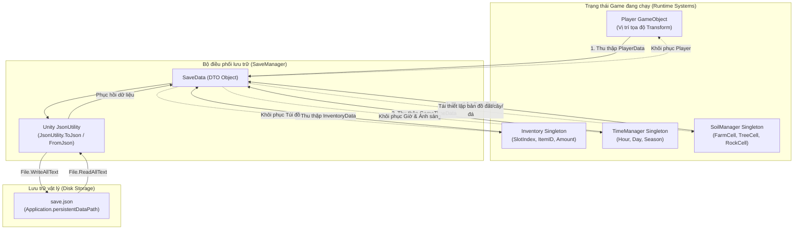
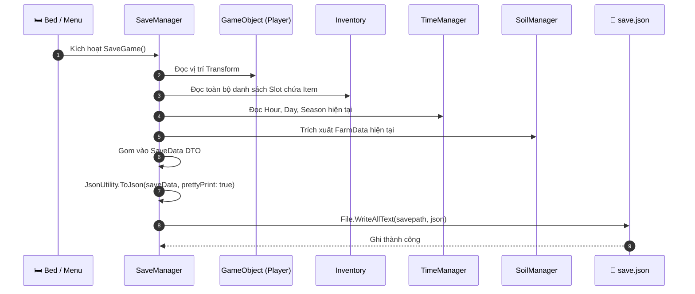
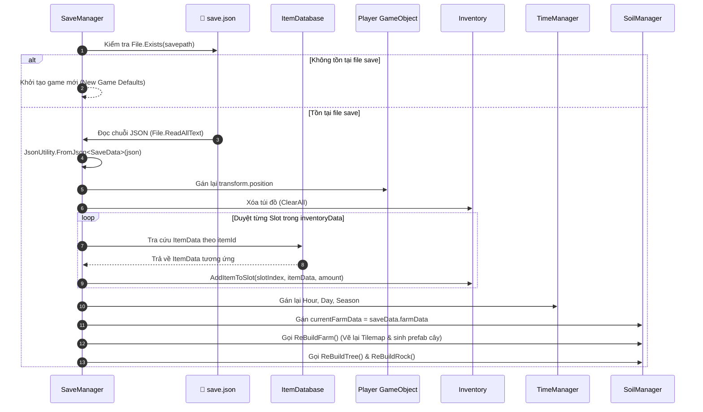

# Tài liệu Thiết kế Kỹ thuật: Hệ thống Lưu & Tải dữ liệu (Save & Load System)

> **Dự án**: Farm RPG (Totnghiep2026)  
> **Thành phần**: Lưu trữ trạng thái thế giới, Nhân vật, Túi đồ, Nông trại và Thời gian  
> **Tài liệu liên quan**: [Player System](file:///d:/Game_Project/Totnghiep2026/docs/player_design.md) | [Farming System](file:///d:/Game_Project/Totnghiep2026/docs/farming_design.md) | [Tổng quan docs](file:///d:/Game_Project/Totnghiep2026/docs/README.md)

---

## 1. Tổng quan kiến trúc (Architectural Overview)

Hệ thống Lưu & Tải dữ liệu (`Save & Load`) đóng vai trò đảm bảo tính liên tục của trải nghiệm người chơi trong game mô phỏng nông trại. Hệ thống sử dụng mô hình **Tập hợp dữ liệu trung tâm (Data Aggregation)**: gom toàn bộ trạng thái phân tán của các Singleton runtime vào một đối tượng duy nhất ([`SaveData`](file:///d:/Game_Project/Totnghiep2026/Assets/Scripts/SaveData.cs)), sau đó tuần tự hóa (Serialize) thành định dạng JSON và lưu vào ổ đĩa thông qua [`SaveManager`](file:///d:/Game_Project/Totnghiep2026/Assets/Scripts/SaveManager.cs).



---

## 2. Các thành phần mã nguồn cốt lõi (Core Components)

| Class | File Source | Vai trò |
|---|---|---|
| [`SaveManager`](file:///d:/Game_Project/Totnghiep2026/Assets/Scripts/SaveManager.cs) | `Assets/Scripts/SaveManager.cs` | Quản lý vòng đời lưu/đọc file `save.json`, Singleton điều phối việc snapshot và restore dữ liệu. |
| [`SaveData`](file:///d:/Game_Project/Totnghiep2026/Assets/Scripts/SaveData.cs) | `Assets/Scripts/SaveData.cs` | Root DTO class chứa tất cả các phần dữ liệu con cần lưu trữ. |
| [`PlayerData`](file:///d:/Game_Project/Totnghiep2026/Assets/Scripts/PlayerData.cs) | `Assets/Scripts/PlayerData.cs` | DTO lưu trữ vị trí tọa độ của nhân vật (`Vector3 position`). |
| [`InventoryData`](file:///d:/Game_Project/Totnghiep2026/Assets/Scripts/InventoryData.cs) | `Assets/Scripts/InventoryData.cs` | DTO lưu trữ sức chứa balo (`capacity`) và danh sách các ô vật phẩm. |
| [`InventorySlotData`](file:///d:/Game_Project/Totnghiep2026/Assets/Scripts/InventorySlotData.cs) | `Assets/Scripts/InventorySlotData.cs` | DTO lưu trữ từng ô đồ: `slotIndex`, `itemId`, `amount`. |
| [`GameTimeData`](file:///d:/Game_Project/Totnghiep2026/Assets/Scripts/GameTimeData.cs) | `Assets/Scripts/GameTimeData.cs` | DTO lưu trữ thời gian: `currentHour`, `currentDay`, `currentSeason`. |
| [`FarmData`](file:///d:/Game_Project/Totnghiep2026/Assets/Scripts/FarmData.cs) | `Assets/Scripts/FarmData.cs` | DTO lưu trữ danh sách các ô đất nông trại ([`FarmCell`](file:///d:/Game_Project/Totnghiep2026/Assets/Scripts/Cell/FarmCell.cs)), cây cối ([`TreeCell`](file:///d:/Game_Project/Totnghiep2026/Assets/Scripts/TreeCell.cs)) và đá ([`RockCell`](file:///d:/Game_Project/Totnghiep2026/Assets/Scripts/Cell/RockCell.cs)). |
| [`ItemDatabase`](file:///d:/Game_Project/Totnghiep2026/Assets/Scripts/ItemDatabase.cs) | `Assets/Scripts/ItemDatabase.cs` | Bảng tra cứu `ItemData` thông qua chuỗi định danh `itemId` khi nạp game. |

---

## 3. Cấu trúc Lược đồ Dữ liệu JSON (Data Schema Definition)

File lưu game được lưu mặc định dưới đường dẫn:  
`Application.persistentDataPath/save.json`

```json
{
  "playerData": {
    "position": {
      "x": 12.5,
      "y": -4.2,
      "z": 0.0
    }
  },
  "inventoryData": {
    "capacity": 24,
    "slots": [
      {
        "slotIndex": 0,
        "itemId": "tool_hoe",
        "amount": 1
      },
      {
        "slotIndex": 1,
        "itemId": "tool_watering_can",
        "amount": 1
      },
      {
        "slotIndex": 2,
        "itemId": "seed_parsnip",
        "amount": 15
      }
    ]
  },
  "gameTimeData": {
    "currentHour": 6.0,
    "currentDay": 3,
    "currentSeason": 0
  },
  "farmData": {
    "farmId": "main_farm",
    "playerId": "player_01",
    "cells": [
      {
        "position": { "x": 5, "y": 2, "z": 0 },
        "state": 2,
        "wateredToday": true,
        "growthDays": 2,
        "daysToMature": 4,
        "cropId": "crop_parsnip",
        "isWithered": false,
        "untillDays": 0,
        "fertilizer": 1,
        "originTileName": "spring_grass_0"
      }
    ],
    "treeCells": [],
    "rockCells": []
  }
}
```

---

## 4. Quy trình Thực thi (Execution Flows)

### 4.1. Quy trình Lưu game (Save Workflow)
Thời điểm kích hoạt lưu game:
1. **Người chơi đi ngủ (Ngủ qua đêm tại Giường)**: Đây là thời điểm chuẩn nhất để chốt dữ liệu ngày hôm đó.
2. **Khi thoát ứng dụng (`OnApplicationQuit`)**: Bảo toàn tiến trình nếu đóng game đột ngột.
3. **Thao tác thủ công qua Menu**: Người chơi chọn nút "Lưu game".



### 4.2. Quy trình Tải game (Load Workflow)
Được kích hoạt khi bắt đầu Scene tại `SaveManager.Start()`.



---

## 5. Tái cấu trúc Thế giới Nông trại sau khi Load (World Reconstruction)

Để tránh lưu trữ toàn bộ các GameObject phức tạp của Unity, `SaveManager` chỉ lưu dữ liệu thuần (Pure Data). Trong hàm `SoilManager.ReBuildFarm()`:
1. **Duyệt qua danh sách `cells` trong `FarmData`**:
   - Nếu ô có trạng thái `Tilled`: vẽ `soilTile` lên `groundTileMap`.
   - Nếu ô có cờ `wateredToday == true`: vẽ đè `soilWetTile`.
   - Nếu ô có `fertilizer != FertilizerType.None`: vẽ tile hiển thị phân bón lên `fertilizerTileMap`.
   - Nếu ô có `state == Seeded` và có `cropId`:
     - Tra cứu `CropData` trong danh sách đăng ký.
     - Sinh prefab [`CropTile`](file:///d:/Game_Project/Totnghiep2026/Assets/Scripts/CropTile.cs) tại tọa độ thế giới tương ứng.
     - Khởi tạo sprite theo giai đoạn sinh trưởng đã lưu: `cropTile.Init(cropData, cell.growthDays, cell.isWithered)`.

---

## 6. Đề xuất Tối ưu & Hướng phát triển (Future Enhancements)

1. **Hỗ trợ Đa Slot Lưu (Multiple Save Slots)**:
   - Hiện tại hệ thống sử dụng cố định một file `save.json`.
   - Đề xuất: Cho phép tạo `save_slot_1.json`, `save_slot_2.json`, `save_slot_3.json` kèm metadata hiển thị trên UI Menu (Tên nông trại, số ngày đã chơi, số tiền hiện có, ngày giờ lưu).
2. **Cơ chế Sao lưu An toàn (Atomic Save & Backup)**:
   - Ghi dữ liệu ra file tạm `save.json.tmp` trước, sau khi ghi hoàn tất mới thay thế `save.json` để phòng tránh hỏng file (corrupted save) nếu máy bị mất điện hoặc crash đột ngột trong lúc ghi đĩa.
3. **Mã hóa hoặc Nén dữ liệu (Data Compression/Encryption)**:
   - Dùng nén GZip hoặc mã hóa Base64 / AES đơn giản để tránh người chơi chỉnh sửa file JSON gian lận số tiền hoặc vật phẩm.
4. **Bổ sung Dữ liệu Người chơi còn thiếu**:
   - Mở rộng [`PlayerData`](file:///d:/Game_Project/Totnghiep2026/Assets/Scripts/PlayerData.cs) để lưu:
     - `currentStamina` (tránh reload game để hồi đầy thể lực).
     - `currentMoney` (tránh mất tiền kiếm được trong ngày).
     - Hướng quay mặt (`facingDirection`).
